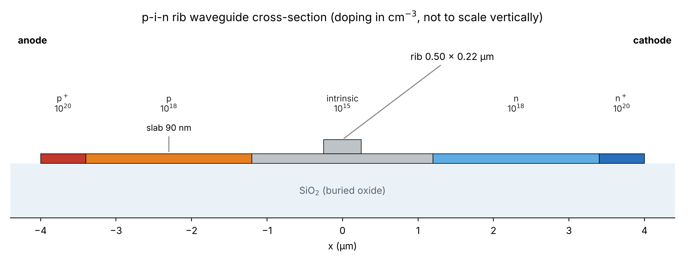
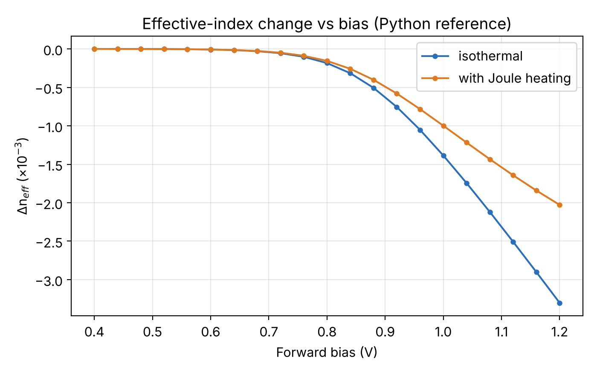
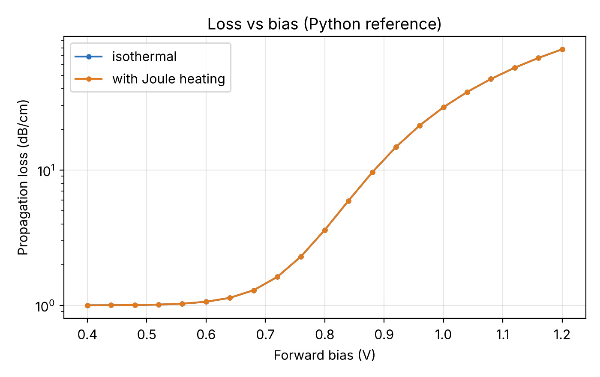
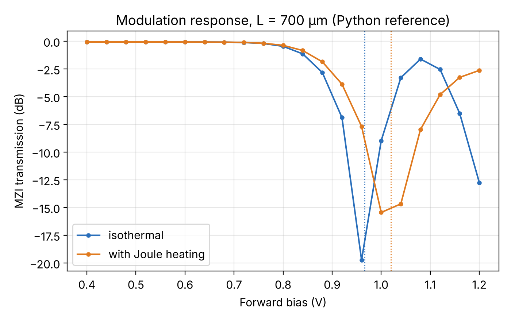

# Forward-Biased PIN Mach-Zehnder Modulator with Ansys Lumerical CHARGE and MODE

Electro-optical design study of a silicon p-i-n phase shifter used in a Mach-Zehnder modulator, with **Ansys Lumerical CHARGE** (carrier transport, optionally coupled to HEAT) and **Ansys Lumerical MODE** (eigenmode solver), both driven from Python through `lumapi`.



## What it answers

How much phase shift, loss and modulation depth do I get per volt from carrier injection into a quasi-intrinsic rib waveguide, and how much does self-heating at high current work against it?

## Workflow

```
lumerical/pin_charge.py        CHARGE: bias sweep of the p-i-n diode, saves carrier densities (and temperature)   ->  data/pin_charge.mat, data/pin_temp.mat
lumerical/pin_mode_sweep.py    MODE: carrier data -> index perturbation -> fundamental mode at each bias           ->  data/neff_vs_v_*.csv
analysis/modulator_analysis.py MZI model: phase, transmission, V_pi, extinction ratio, insertion loss             ->  images/, data/metrics.json
```

1. **CHARGE.** A 0.50 × 0.22 µm rib on a 90 nm slab, with p+/p, a 2.4 µm lightly doped intrinsic region and n/n+ (see figure), is swept from 0.4 V to 1.2 V forward bias. A charge monitor stores the electron and hole densities at every bias point.
2. **MODE.** The densities are loaded into an `np density` grid attribute. An index-perturbation material (Soref-Bennett model) converts carriers into changes of refractive index and absorption, and the fundamental TE mode is solved at each bias.
3. **Electro-thermal case (optional).** Running CHARGE in coupled mode adds Joule heating. The saved temperature profile is loaded into a `temperature` grid attribute and the sweep is repeated.
4. **Analysis.** One arm of a balanced MZI of length L carries the phase shifter. From the sweep: `φ(V) = 2πL·Δn_eff/λ` and `T(V) = |½(a_ref + a_act·e^{jφ})|²`, giving V_π, extinction ratio (T at 0 phase vs T at V_π), insertion loss and V_π·L.

## Run

Requirements: Ansys Lumerical (CHARGE/DEVICE and MODE) with the Python API, Python 3.8+, `numpy`, `scipy`, `matplotlib`.

```bash
pip install -r requirements.txt
cd lumerical
python pin_charge.py --hide                          # isothermal CHARGE sweep
python pin_mode_sweep.py --hide                      # optical sweep -> data/neff_vs_v_isothermal.csv

python pin_charge.py --hide --electrothermal         # optional coupled electro-thermal run
python pin_mode_sweep.py --hide --electrothermal     # -> data/neff_vs_v_electrothermal.csv

cd ../analysis
python modulator_analysis.py --length-um 700         # figures -> ../images
```

**One-time material setup.** MODE needs an index-perturbation material. If `pin_mode_sweep.py` reports that it could not create it by script, make it once in the GUI: *Materials → Add → Index perturbation*, name it `Si_index_pert`, base material `Si (Silicon) - Palik`, enable the np-density model *Soref and Bennett* (and, for the electro-thermal run, the temperature model with a linear sensitivity of about 1.8×10⁻⁴ K⁻¹). Then re-run; use `--material` to pass a different name.

If `lumapi` is not importable, set `LUMAPI_PATH` to Lumerical's `api/python` folder.

## Results

Generated into `images/` by `analysis/modulator_analysis.py` from the CHARGE/MODE sweeps:





Key numbers (V_π, V_π·L, extinction ratio, insertion loss, and the V_π shift caused by Joule heating) are written to `data/metrics.json`.

## Python reference model

`reference_model/` holds a small analytical model of the same device: a diode with series resistance sets the current, a lifetime sets the injected carrier density, the Soref-Bennett relations give the index and absorption change, and a thermo-optic term represents Joule heating. It writes the same CSV files and runs the same analysis. Its parameters are illustrative and **not calibrated** against CHARGE or MODE, so treat it as a check of the analysis pipeline and of the qualitative physics, not as a prediction for the Lumerical device.


With the illustrative parameters the reference device reaches a π phase shift at about 0.97 V for a 700 µm arm (V_π·L ≈ 0.07 V·cm), with roughly 15 dB extinction ratio. Joule heating raises the thermo-optic index and pushes V_π up by about 0.05 V, because the thermal index increase opposes the carrier-induced decrease.

## Limitations

- The Lumerical scripts have not been run by me; the geometry, doping and solver settings are my own design and may need tuning (mesh, contact settings, convergence) on your installation.
- Property names can differ between versions. Anything a script cannot set is reported as `[warning] ...` rather than failing silently. The coupled electro-thermal setup in particular also needs a HEAT solver, thermal boundary conditions and thermal conductivities that may have to be added in the GUI.
- Steady-state (DC) analysis only: no carrier-transport dynamics, so no bandwidth or RF response.
- The MZI model assumes a balanced interferometer with one active arm and a passive arm whose loss equals the active arm's loss at the lowest bias.
- Carrier lifetime and surface recombination strongly affect the result and are not calibrated here.

## Acknowledgement

The study follows the approach of the Ansys Lumerical example *"PIN Mach-Zehnder modulator"* (CHARGE + MODE, with an electro-thermal extension): https://optics.ansys.com/hc/en-us/articles/360042327854-PIN-Mach-Zehnder-modulator

The device geometry, scripts, analysis, text and figures in this repository are my own.

## Author

Ripon Kumar Dey, PhD
